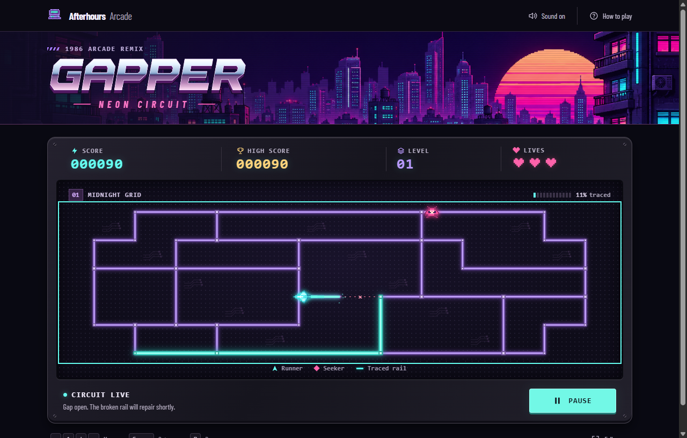

# Gapper · Neon Circuit

*Neon Circuit* is a single-player rail chase. Fly the cyan ship over every violet rail while the pink seeker takes the shortest open route to intercept you. Cutting a rail behind you buys 3.6 seconds, but it also closes your own way back.

The camera stays above the board in both steering schemes. In **Third person**, Left always means the left side of the screen. In **First person**, Left means the ship’s left. When the ship is heading down the screen, that same input sends it toward the right edge.

**[Play it in your browser](https://iago-swi.github.io/gapper/ChatGPT/)**



**Play offline.** Download [Gapper.html](https://raw.githubusercontent.com/iago-swi/gapper/main/ChatGPT/Gapper.html), save it as an HTML file, and open it in a modern browser. It includes the scripts, styles and skyline image. To work on the source, clone the repository and open this folder’s `index.html`. Both editions run directly from disk.

## Controls

Choose a steering scheme before starting, while paused, or at game over. Switching schemes clears any pending turn and takes effect immediately.

| Scheme or action | Keyboard | Touch |
| --- | --- | --- |
| Third person (default) | Arrow keys or WASD point in screen directions. The opposite direction reverses the ship mid-rail. | Four-way pad or swipe the playfield |
| First person | Left/Right or A/D turn relative to the ship. Up/Down and W/S have no effect. | Tap the left or right pad button to turn on touch-down |
| Break the last completed rail | Space | Cut gap |
| Pause or resume | P | Pause or Resume |

## How the game works

The runner starts with three lives. The first crossing of a rail earns 10 points. A collision costs one life and preserves all traced rails. Completing the circuit awards another 100 points multiplied by the current level. Three handcrafted layouts cycle as the seeker gets faster.

## Technical notes

### Source and offline delivery

Two classic JavaScript files divide the work. `Circuit.Game` owns positions, routes, score and lives. It accepts steering commands and elapsed time and emits events such as `rail`, `gap` and `hit`. The browser code subscribes to those events. A single `rail` event refreshes the scoreboard, marks the board image for redrawing, plays a short tone and emits four cyan sparks. The engine itself can run without a canvas or audio device.

| File | Responsibility |
| --- | --- |
| [engine.js](engine.js) | Builds the rail graphs and advances movement, pursuit, gaps, scoring, lives and level transitions. |
| [arcade.js](arcade.js) | Connects input to the engine, draws the board and sprites with Canvas 2D, updates the scoreboard and synthesizes sounds with the Web Audio API. |
| [screen.css](screen.css) and [index.html](index.html) | Define the cabinet, responsive layout, touch controls and instructions dialog. |
| [midnight-city.png](midnight-city.png) | The custom pixel-art skyline generated for this edition. |
| [Gapper.html](Gapper.html) | Portable, single-file edition containing the same game and artwork. |

The editable edition loads both scripts in order with `defer`. The standalone edition embeds their contents, the stylesheet and the skyline PNG in one HTML file. Both use built-in browser APIs and run directly from disk.

### Building the rail graph

Every board starts with the same stepped outer loop. Each layout adds a different set of horizontal and vertical runs inside it. The builder walks each run one grid unit at a time, creates or reuses a node for each coordinate, and connects successive nodes in both directions. Overlapping runs share nodes and rails. A T-junction emerges wherever a third exit meets an existing node.

A rail’s identifier consists of its two endpoint IDs in sorted order. Crossing from `(3,5)` to `(3,4)` and crossing back therefore count as visits to the same rail. The engine adds that ID to a `Set` on the first completed crossing. The screenshot shows nine completed rails on Midnight grid, worth 90 points. The HUD rounds 9 out of 76 down to 11%.

| First appearance | Layout repeats as | Nodes | Rails to trace | Junctions with 3 or 4 exits |
| --- | --- | ---: | ---: | ---: |
| 1 · Midnight grid | 4 · Afterburn | 65 | 76 | 20 |
| 2 · Violet relay | 5 · Night drive | 65 | 78 | 21 |
| 3 · Ghost junction | 6 · Last light | 64 | 77 | 20 |

The six names repeat from level 7. Difficulty follows the level number, so returning to Midnight grid gives the seeker a familiar course at a higher speed.

### Movement and queued turns

Each actor stores its departure node, destination node, heading and a fraction `t` between 0 and 1. The runner travels at **3.6 rails per second**. Each frame gives it a distance budget equal to speed times elapsed time. Reaching a node consumes the distance to that node, records the crossing and leaves any remaining budget for the next rail. Interpolating between endpoints gives the renderer a smooth position throughout the move.

Third-person steering handles the initial keydown immediately and ignores auto-repeat. The latest screen direction stays queued until an exit opens or another direction replaces it. Pressing the opposite direction mid-rail reverses the ship immediately. Returning to the departure node leaves a partially crossed rail unscored.

Both schemes allow a late sideways turn up to **0.3 of a segment** after a node. If the side exit was open there, the runner transfers to that rail at the same distance from the node. Collision checks use the new position immediately. The sprite carries the difference between the old and new positions as a visual offset, multiplied each frame by `exp(-30 × dt)` with `dt` in seconds. About 5% of the offset remains after 0.1 seconds. The abandoned crossing earns no points, and the assist stays off while retracing a segment in reverse.

In first person the ship sets off automatically on launch and on each new life. A relative turn stays queued for one second. At each node the runner tries that turn, then straight ahead, then a sole open side exit. If straight is blocked and both sides are open, the runner waits with its arrival heading intact. It never chooses a U-turn.

`requestAnimationFrame` supplies the clock. Each update consumes at most 50 milliseconds of elapsed time, limiting how far either actor advances after a slow frame. Positions, speed and collision distance use grid units, so resizing the cabinet changes how the board is drawn while preserving the rules.

**Two inputs at the same junction.** On Midnight grid, head down the right edge from `(12,2)` toward `(12,3)`. Both nodes have an exit to screen-left. A third-person Left press at `t = 0.15` puts the runner 0.15 units along the branch from `(12,2)`. The same press at `t = 0.50` stays queued. The runner finishes the downward rail, then takes the left branch from `(12,3)`. In first person the equivalent input on this approach is **Right**.

The one-second relative-turn buffer uses the browser’s monotonic clock (`performance.now()`). The 3.6-second repair timer uses simulation time. If you pause for two seconds with a turn queued and a gap open, the gap still has its remaining time when you resume, and the queued first-person turn has expired.

### The seeker and the gap

At each node the seeker runs a breadth-first search through the available exits. It targets the node the runner is moving toward, or the runner’s current node while stationary. Each queue entry remembers the first direction taken from the seeker’s position. When the search finds the target, that direction is the next move on a shortest route. The seeker commits to one rail and searches again at the next node.

**A gap changes the route for both ships.** On Midnight grid, the link from `(3,5)` to `(3,4)` normally takes one step. Cut that link and the shortest open route between its endpoints takes five:

```text
(3,5) → (2,5) → (1,5) → (1,4) → (2,4) → (3,4)
```

Space targets the last rail the runner finished. A cut succeeds when that rail exists, neither ship is partway across it, and any earlier gap has healed. For **3.6 seconds of play**, the shared exit lookup skips the broken rail in both directions. Repair restores the exit. Its traced status and points survive the cut.

### Difficulty, collisions and restarts

The seeker starts at 2.02 rails per second and gains 0.15 per level, up to 3.25 from level 10 onward. Each spawn gives the runner a 1.4-second head start. Once pursuit begins, the engine measures the distance between the actors’ interpolated positions each update. A distance below 0.3 grid units costs a life, so two ships can collide midway along a rail.

| Event | What carries forward |
| --- | --- |
| Caught with a life remaining | Both ships return to their starting nodes and the gap clears. First person relaunches after one second. **Continue** launches immediately. The score and traced rails carry over. |
| Last rail traced | **Next level** loads the next layout with a fresh trace set. Score and remaining lives carry over. Clearing Midnight grid earns 860 points in total, including the 100-point level bonus. |
| Last life lost | **Play again** starts at level 1 with three lives and zero points. The personal best survives. |

### How the cabinet draws a frame

1. **Build the rail layer.** An offscreen canvas holds the etched circuit marks, tracks and junctions. Two `Path2D` objects group the violet and cyan rails. Each receives a broad halo, a narrower colored stroke and a thin bright core. An open gap gets a dashed line and a cross at its midpoint. The renderer reuses this layer until an engine event or resize invalidates it.
2. **Draw the crossing in progress.** Each frame copies the cached board and draws a cyan line from the runner’s departure node to its current position. This lets the player see the rail light up under the ship. The score changes on arrival at the far end.
3. **Draw the actors and effects.** Each sprite starts as rows of palette characters that are rasterized once into a small canvas. The runner rotates to face its heading. Scaling with image smoothing disabled preserves the pixel edges. A new rail throws off four sparks, and a collision releases 28 pink particles. Both fade over half a second.

The skyline above the board is a separate PNG. The chrome Gapper title is drawn from polygon letters with a gradient and clipped highlights. The scoreboard, instructions and buttons are HTML. A `ResizeObserver` refits the board to its display size and caps the canvas backing resolution at twice the CSS pixel dimensions.

### Sound, input and browser storage

Each sound uses a Web Audio oscillator and a gain envelope with an 8 ms attack. A newly traced rail plays a 60 ms sine tone whose starting pitch cycles through five values. Cutting a gap sweeps a sawtooth from 850 to 120 Hz over 200 ms. A collision drops from 155 to 34 Hz over 450 ms. Clearing the level schedules four triangle tones 90 ms apart, starting on the root, major third, fifth and octave. The browser creates or resumes the audio context after a player action.

Keyboard turns and pad presses share the same steering method. In third person a swipe fires as soon as either axis reaches 10 CSS pixels, using the dominant axis. Opening the instructions pauses a live round. Switching tabs also pauses the simulation, including the gap timer. The reduced-motion preference suppresses particle bursts and the animated exhaust flame.

| Browser storage key | Value | When it is written |
| --- | --- | --- |
| `gapper.controls` | `third` (default) or `first` | As soon as a steering option is selected |
| `gapper.sound` | `on` (default) or `off` | When the sound button is pressed |
| `gapper.best` | Highest eligible score, in points | At game over, or when the browser sends a `pagehide` event without keeping the page in its back/forward cache |

During an eligible run, the high-score display can rise with the current score before the record is written. Lives, traced rails and the open gap stay in memory, so reloading starts a fresh circuit. If storage is unavailable, the current session remains playable.

<details><summary>Easter egg (spoiler)</summary>

Type **PAX** on any screen to toggle practice. An olive branch appears while the seeker can chase you harmlessly. Completing the word restores the pause state from before its P key. Toggling practice off restores collisions. A run that used practice at any point is ineligible for the best score, even if practice was off at game over. Reloading switches practice off.

</details>

[Game history and gameplay screenshot](../README.md)
