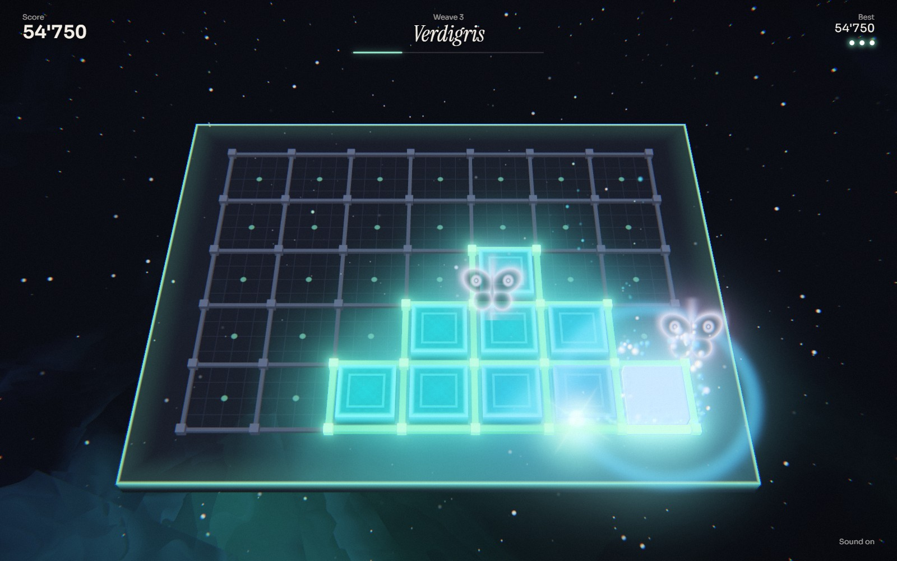

# Lightloom — Claude version

A line-weaving arcade game built with Claude (Anthropic), in the genre of *Gapper* and
*Amidar* but with its own theme: you run a shuttle of light along the threads of a
floating loom. Run the full length of a thread to weave it, close all four sides of a
square to light it, and stay ahead of the moths that hunt the light.

Graphics and sound are generated in the browser (WebGL 2 and Web Audio). There are no
image or audio files and no libraries.

**[Play it in your browser](https://iago-swi.github.io/gapper/Claude/)**

The version number is shown on the title screen. The [changelog](CHANGELOG.md) lists
what changed in each version.

## Run it

Play online with the link above. To play offline, download [Lightloom.html](https://raw.githubusercontent.com/iago-swi/gapper/main/Claude/Lightloom.html),
save it as an HTML file and open it in a current version of Chrome, Edge, Firefox or
Safari. That single file contains the whole game. To work on the source, clone the
repository and open this folder's `index.html`. Both run directly from disk; no
installation, build step or web server is needed. The two typefaces load from Google
Fonts; without an internet connection the game falls back to system fonts.

## How to play

Steer the shuttle along the threads. It keeps moving in its current direction, so you
can press the next turn before you reach the knot. A thread is woven only once you
have run its whole length; turn back halfway and it unravels. A square lights when
its four threads are woven. Light every square to finish the weave.

There are two ways to steer. Choose one on the title screen or while paused; the
choice is remembered.

| Controls | Keyboard | Touch screen |
| --- | --- | --- |
| Third person | The arrow keys or `WASD` point the way to go. The opposite direction turns the shuttle back at once. | Swipe |
| First person | `←` and `→` (or `A` and `D`) turn the shuttle left or right of its heading. It sets off by itself and cannot turn back. | Tap the left or right side |

| Key | Action |
| --- | --- |
| `P` or `Esc` | Pause |
| `M` | Sound on/off |
| `F` | Full screen |
| `Enter` or `Space` | Start |
| `Esc` after a game | Back to the title screen |

When a game ends, "Weave again" starts the next one and "Title screen" leads back to
the opening screen. A paused game can be given up with "End this run": it ends like
any other game, and its score counts.

Moths travel along the same threads and touching one costs a spark. You start with
three sparks. Your defense is the loom itself: a freshly lit square stuns every moth
within two squares of it for 1.8 seconds, and a stunned moth is harmless. Lighting
squares in quick succession builds a chain that multiplies their score.

The ten best scores are kept in the browser, each with three initials, the weave
reached and the date. The list is shown when a game ends and opens from the title
screen under "High scores". A score that makes the list is saved at once; the initials
can be typed or changed next to it and are remembered for the next game.

Next to "This device" there is a second tab, "Everyone": the ten best scores of all
players of the online game and of the single-file edition. Every finished game with a
score is sent there with your initials, and nothing else about you.

Easter egg (spoiler)

Type `PAX` at any time, on any screen, to switch practice mode on or off. While it is
on, the moths cannot hurt the shuttle, and a small olive branch with the word PAX
shows in a corner of the screen. A run in which practice mode was used is not entered
in the high scores.

## Technical notes

### Stack

| | |
| --- | --- |
| Delivery | `index.html` plus three scripts in `js/`, about 1700 lines (96 KB) in total. `Lightloom.html` is the same game with the scripts inlined. No dependencies, no build step. |
| Language | Plain JavaScript (ES2020) in classic scripts, no framework. |
| Rendering | WebGL 2 (GLSL ES 3.00) for the whole scene and post-processing. HTML and CSS for the score bar, banners and screens. |
| Sound | Web Audio API. Every sound is synthesized; there are no audio files. |
| Type | Instrument Serif and Sora from Google Fonts, with system fallbacks. |
| Storage | `localStorage` only: `lightloom.scores` (the high-score list), `lightloom.name` (the initials used last), `lightloom.best`, `lightloom.controls` (the steering choice) and `lightloom.list` (which list is on view). |
| Version | Written once, in `index.html` (the line shown on the title screen). Each version has a section in [CHANGELOG.md](CHANGELOG.md), a tag `lightloom-v…` and a release on GitHub; the rules are in [VERSIONING.md](../VERSIONING.md). |
| Requirements | A browser with WebGL 2. `EXT_color_buffer_float` is used for HDR render targets when present; otherwise the game falls back to 8-bit targets. |

| File | Responsibility |
| --- | --- |
| [js/gfx.js](js/gfx.js) | Matrix helpers, all shaders, render targets and the frame pipeline. |
| [js/game.js](js/game.js) | Board, rules, movement, moths, particles, camera, input, score bar and the frame loop. |
| [js/audio.js](js/audio.js) | Sequencer, instruments and sound effects. |
| [index.html](index.html) | Markup and CSS for the title, score bar, banners, pause and game-over screens. |
| [Lightloom.html](Lightloom.html) | Portable single-file edition. |
| [CHANGELOG.md](CHANGELOG.md) | What changed in each version. |
| [scores-worker/](scores-worker/) | Web service for a high-score list shared between players. Not part of the game files; see [High scores](#high-scores). |

### The board

A weave of *c* × *r* squares is stored as three arrays: (*r* + 1) × *c* horizontal
threads, *r* × (*c* + 1) vertical threads, and *r* × *c* squares. Each thread holds a
woven flag; each square holds a lit flag and a count of its woven sides.

An actor (the shuttle or a moth) is a knot, a direction, a progress value from 0 to 1
along the current thread, and a sign for travel forward or back. Movement consumes a
distance budget per frame, so speed does not depend on the frame rate. A thread is
marked woven only when the shuttle arrives at its far knot. Reversing flips the sign
instead of swapping the end points, so going back to the knot you left weaves nothing
and the half-pulled thread retracts.

In portrait windows (aspect ratio under 0.8) columns and rows are swapped, so the
board stands upright on a phone.

### Steering

A key press is applied inside the key handler, not on the next frame. What it does
depends on the controls.

- **Third person.** The pressed direction is remembered and taken at the next knot
  where it is possible. The direction opposite to travel reverses at once.
- **First person.** Left and right are measured from the shuttle's heading. A turn is
  held for one second and taken at the first knot where it is open; after that it
  lapses, so an old key press cannot fire several knots later. The shuttle sets off by
  itself, rounds a corner unprompted and waits at a wall where both ways are open.
  There is no turning back.

Turns can only happen at knots, so the delay a player feels comes from pressing just
after a knot and then riding a whole thread (0.23 s at the starting speed) to the
next one. To remove it, a sideways turn pressed within 0.3 threads past a knot, about
70 ms, is taken at that knot if the turn was open there. The shuttle moves onto the
new thread at the same distance from the knot, the half-pulled thread is dropped, and
the drawn position eases across within a tenth of a second. The window is kept short
because a longer one would also catch turns meant for the next knot.

On a touch screen a swipe counts after 16 pixels, and in first person a tap acts on
touch-down.

### High scores

**On this device.** The list is a JSON array of up to ten entries (initials, score,
weave reached, date) under one `localStorage` key. It is read as untrusted data:
entries of the wrong shape are dropped, initials are reduced to three letters or
digits, and names reach the page as text, never as markup. A score equal to an older
one ranks below it. A best score saved before the list existed becomes its first
entry, without initials. The game played online and a downloaded `Lightloom.html`
keep separate lists, because a browser stores data per address.

While the initials field has the focus, the game's own keys are switched off, so
typing `A`, `M`, `P` or the easter-egg word does nothing but type. Key repeat is
ignored there too, so a steering key still held down when the game ends cannot fill
the field.

**Shared between players.** GitHub Pages only serves files and cannot store a score,
so a shared list needs a service elsewhere. [scores-worker/](scores-worker/) holds
one: a Cloudflare Worker (about 80 lines) in front of a D1 database with a single
table. The game contains the matching code: a second tab, "Everyone", next to "This
device". The service runs at `https://lightloom-scores.iago-swi.workers.dev/`; that
address is the constant `SHARED` in `js/game.js`. With an empty address the game keeps to the device, makes no network requests and hides the
tabs.

| | |
| --- | --- |
| Reading | `GET /?game=lightloom` returns the ten best runs. |
| Writing | `POST` with the initials, the score, the weave reached and a random key that the game makes up for each run. Sending the same key again only changes the initials, so a retry or an edit never adds a second entry. |
| What is stored | Game, key, initials, score, weave, time. No address and no browser details. |
| Checks | A browser game cannot prove its score, so the service refuses only what the rules make impossible: it recomputes the lowest and highest score possible for the weave reached and rejects anything outside, anything not a multiple of 10, and malformed requests. A plausible invented score would pass. |
| Limits | 30 new entries per minute for all players together; 200 rows kept. |
| Failure | If the service cannot be reached the game says so and keeps the score on the device. It is not sent later. |

The request body is sent as plain text, which browsers class as a simple request, so
no CORS preflight is needed and a score costs one round trip.

### Rendering pipeline

Everything on the board is one of two instanced primitives.

- **Boxes.** A unit cube drawn with `drawArraysInstanced`, 14 floats per instance
  (center, scale, color, parameters). One fragment shader paints four kinds of box:
  thread, knot, lit square and the slab underneath. The largest board uses about 320
  instances in one draw call.
- **Billboards.** A quad, 13 floats per instance, either facing the camera or lying
  flat. The fragment shader computes the shape: a soft mote, the shuttle (core, halo
  and four rotating rays), a ring, or a moth. The moth is the union of three ellipse
  distance fields mirrored on the vertical axis, with the horizontal axis scaled by a
  sine to flap the wings. Blending is premultiplied (`ONE, ONE_MINUS_SRC_ALPHA`), so
  alpha 0 adds light and alpha 1 covers what is behind; glowing sparks and the dark
  body of a moth go through the same draw call.

Each frame runs these passes:

1. **Sky.** A full-screen shader. The view ray is projected onto a plane and fed to
   6-octave value noise, rotated between octaves and domain-warped twice, plus two
   layers of stars.
2. **Boxes**, with depth test and back-face culling.
3. **Billboards**, depth-tested but not written to the depth buffer.
4. **Resolve.** Passes 1 to 3 draw into a 4× multisampled `RGBA16F` renderbuffer,
   which is blitted to a texture.
5. **Bloom.** A threshold pass (0.85), then six levels of dual-filter downsampling
   and additive upsampling.
6. **Final grade.** Up to four shockwave distortions, a slice glitch when a spark is
   lost, chromatic aberration, tone mapping, a vignette and film grain.

Colors are kept in linear HDR until the last pass. A lit thread is brighter than 1.0,
and bloom spreads only that excess, which is why light bleeds from threads and
squares but not from the slab. The tone mapper is an even mix of the ACES curve
applied per channel and the same curve applied to the peak channel only; the second
half keeps bright colors from washing out to white.

The slab and the lit squares reflect the sky by calling the sky function again along
the reflected view ray, weighted by a Fresnel term. Light spilling from lit squares
onto the slab comes from a light map: a *c* × *r* RGBA texture uploaded every frame,
where RGB is the color of each lit square and alpha is the number of woven sides of
each unlit one. The slab shader averages nine bilinear taps of it and uses the alpha
channel to make a square glow faintly as its sides fill in.

The camera has a 36° field of view and looks down at 56°. Its distance and aim point
are found by bisection so that the projected corners of the board stay within 90% of
the width and 73% of the height of the window, which leaves room for the score bar.

The render resolution follows the device pixel ratio up to 2 and is capped at
3.7 megapixels. If 90 consecutive frames average under 45 frames per second, the
internal resolution drops by a fifth, down to half at most.

### Moths

At each knot a moth chooses among the exits other than the one it came from. With a
probability that rises with the weave it takes the exit closest to its target;
otherwise it picks at random.

| Moth | Target |
| --- | --- |
| First | The shuttle. |
| Second | A point 2.5 threads ahead of the shuttle. |
| Third | The shuttle, but it chases only 60% as often as the others. |

A moth touches the shuttle at a distance of 0.42 threads. After losing a spark the
shuttle returns to its starting knot and cannot be hit for 2.2 seconds.

### Difficulty and scoring

| | Weave 1 | Later |
| --- | --- | --- |
| Board | 6 × 4 | 7 × 4, 7 × 5, 8 × 5, 9 × 5, 9 × 6, 10 × 6, then 10 × 7 from weave 8 |
| Moths | 1 | 2 from weave 3, 3 from weave 6 |
| Shuttle speed (threads per second) | 4.3 | +0.11 per weave up to weave 9 |
| Moth speed (share of shuttle speed) | 60% | +3.5 points per weave, up to 90% |
| Chance that a moth chases at a knot | 62% | +5 points per weave, up to 95% |

A woven thread scores 10. A lit square scores 100 times the chain, which grows by one
for each square lit within 3 seconds of the last, up to 9. Finishing a weave under
par (2.4 seconds per square) adds 100 points per second saved. Every third weave
gives a spare spark, up to five.

The five dyes (Indigo, Saffron, Verdigris, Madder, Orchil) each set the thread color,
the two colors of the lit squares, the moth color and the two nebula colors. They
repeat from weave 6.

### Sound

A sequencer schedules sixteenth notes a quarter of a second ahead, polled every
50 ms. The harmony is one bar each of A minor, F, C and G. A pad of six detuned
sawtooth oscillators runs through a swept low-pass filter. During play a kick, a
noise hi-hat, a triangle bass and an arpeggio join in, with a feedback delay
(0.33 s) for space. The tempo starts at 99 beats per minute and rises by 3 per weave
up to 132.

Weaving a thread plays the next note of the A minor pentatonic scale over two
octaves, in the key of the music, and the run starts again after 1.1 seconds of
silence. Lighting a square plays a four-note figure whose root rises with the chain.

### Title screen

The board behind the title is the real game played by a simple bot. At each knot it
takes the unwoven thread next to the square with the most woven sides; when no
unwoven thread touches the knot, a breadth-first search finds the nearest one.

### Accessibility and behavior

- With `prefers-reduced-motion`, screen shake, shockwaves, the chromatic flash and
  the glitch are reduced to a quarter and the title animation is switched off.
- Closing a square never bends or moves the picture, because the player is following
  the shuttle and the moths at that moment. It is marked on the board only: sparks, a
  flash of the square and a faint ring of light as wide as the stun. The screen-wide
  effects (shockwave distortion, shake, color fringe) are kept for moments when play
  has stopped: losing a spark and the fireworks after a weave.
- The game pauses when the window loses focus.
- A run given up with "End this run" goes through the same game-over step as a lost
  one, so it is scored, listed and sent to the shared list in the same way. "Title
  screen" returns to the opening screen and restarts the demo board behind it.
- Scores are formatted with Swiss thousands separators (16’440).

### Testing

`window.__loom` exposes the game state and a `tick(n, dt)` function that advances the
simulation by fixed steps. The game was checked with scripted runs through this hook
(weaving, chains, losing a spark, weave change, game over, phone layout), and with a
real click and real key presses for starting, steering and pausing. The two control
schemes, the late-turn window and practice mode were checked the same way, with
simulated key presses; they have not been tried on a real touch screen. The screenshot
was taken from such a run. The high-score list was checked the same way (first entry,
initials, ties, a full list, a score too low, practice runs, damaged stored data) at
five window sizes from 320 × 568 to 1440 × 900. The shared list was tested against
the Worker running on the development machine with a local database, including
refused scores, renaming, ranking, the rate limit and an unreachable service. The
deployed service was then checked with the same requests and with one complete game
sent from the game itself; the test entries were removed afterwards. The "Title
screen" and "End this run" buttons were checked with scripted runs (a run given up
with and without a score, during play and during the fireworks, `Esc` after a game)
at four window sizes from 320 × 568 to 900 × 560. Sound was not checked by ear, and
frame rate on slower graphics hardware has not been measured.

[Game history and the other versions](../README.md)
