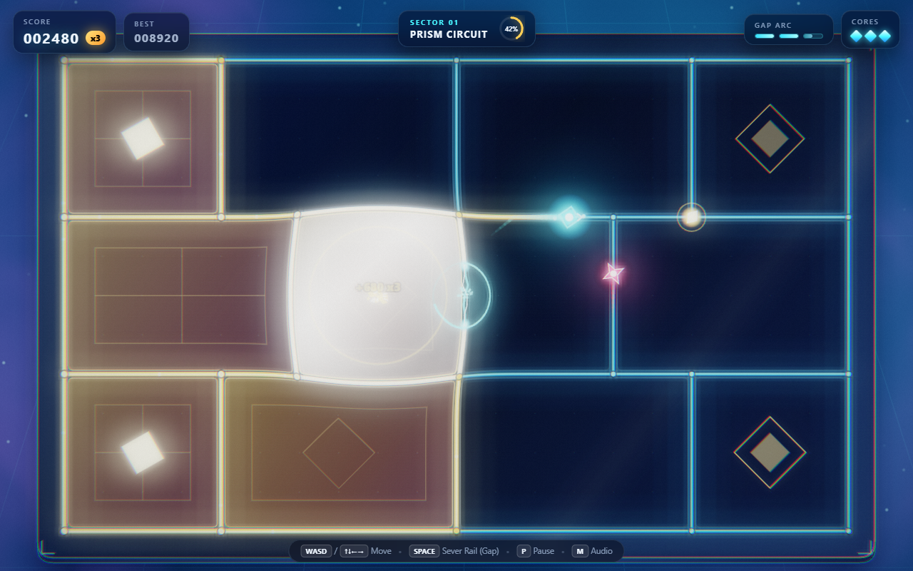

# GAPPER // PRISM — Gemini version

A modern luminous synth-glass reimagining of the 1986 MS-DOS arcade classic *Gapper*, built with Gemini (Google). Glide along glowing optical conduits suspended over a real-time WebGL 2 aurora nebula, enclose staggered rectangular chambers to ignite crystalline prism tiles, and sever rails behind you with crackling high-voltage **Plasma Gaps** to stun or trap pursuing Seekers.

All WebGL 2 shaders, dual-scale Gaussian HDR bloom, radial shockwave refraction, architectural board rendering, and Web Audio synthesizer sounds run locally in the browser with zero external libraries, build steps, or media files.

**[Play it in your browser](https://iago-swi.github.io/gapper/Gemini/)**



## Run it

Download or clone this repository and open `Gemini/index.html` directly in Chrome, Edge, or Firefox. Because modules load via standard `<script>` tags under a shared `window.Gapper` namespace, the game works identically over `file://` (double-click) or any static HTTP server with zero installation or bundler required.

## How to play

Navigate along the conduits of an irregular architectural grid. Every segment you traverse ignites from cool optical sapphire into molten plasma; enclosing all perimeter segments of a chamber seals it in crystalline light, chaining combos and recharging your Gap arcs. Seal every chamber to illuminate the sector and advance.

Two steering schemes are selectable on both the title screen and the pause menu (**Third person** by default, or **First person**), and changes apply immediately.

| Action | Third person (Keyboard) | First person (Keyboard) | Touch |
| --- | --- | --- | --- |
| Steer / Turn | Arrow keys or `WASD` (4 directions; opposite reverses mid-segment) | `Left`/`Right` arrows or `A`/`D` (relative left/right; `Up`/`Down`/`W`/`S` ignored) | Third person: 4-way pad (touch-down) or swipe (`14 px`, `<= 16 CSS px`). First person: Left/Right pad buttons or tap left/right half of the screen (touch-down). |
| Plasma Gap | `Space`, `Shift`, or `E` | `Space`, `Shift`, or `E` | **GAP** button (touch-down) |
| Start / Continue | `Enter` | `Enter` | Tap on-screen button |
| Pause / Resume | `P` or `Esc` | `P` or `Esc` | HUD Pause button |
| Restart sector | `R` | `R` | Pause menu |
| Toggle audio | `M` | `M` | HUD Audio button |

In **First person**, the ship begins moving automatically at the start of a sector and after losing a life. At each junction it takes a queued turn if open, otherwise continues straight if open, otherwise rounds a single open corner unprompted, or waits when both left and right are open (measuring left/right from its arrival direction). Standard HTML5 Gamepad controllers are also supported.

Two high-score lists track the ten best runs: **This device** (stored locally in your browser) and **Everyone** (shared between all players of Prism). Open **High scores** next to your best score on the title screen to browse either list, or enter up to three initials right below the leaderboard on the game-over screen whenever your run qualifies.

| Mechanic / Entity | Behaviour |
| --- | --- |
| **Plasma Gap (`Space`)** | Carves a temporary `4.8 s` high-voltage rift in the rail behind you (up to 3 charges, shown as orbiting diegetic motes around your sprite and in the HUD; recharges passively every `4.2 s` plus `+0.5` per sealed chamber). Neither you nor Seekers can cross an active Gap. |
| **Gap Block & Trap** | A Seeker colliding with an active Gap recoils and is stunned for `1.35 s` (`+150 BLOCKED!`, `+0.35` Gap recharge). Boxing a Seeker between Gaps so it has no open exit overloads and shatters it (`+500 TRAPPED!`). |
| **Prism Overdrive** | Each sector marks its **4 corner chambers** with pulsing golden diamonds. Sealing all four triggers `6.5 s` of **Prism Overdrive**: Seekers slow to `72%`, flee in glitchy cyan, and can be rammed for escalating `+400 × N` shatter bonuses. |
| **Data Shards** | Periodic golden octahedron crystals spawn on distant junctions for `9.5 s`, awarding `+300` and an instant full Gap charge refill. |
| **Combo Chain** | Sealing chambers within `4.6 s` of each other escalates the multiplier up to `×8`. Closing two adjacent chambers with a single rail triggers a **Double Seal (`2×`)** with hit-stop and radial shockwave refraction. |

## Technical notes

### Stack & modular layout

| | |
| --- | --- |
| Delivery | Zero runtime dependencies, zero build step, zero external assets (optional Google Fonts with clean system fallbacks). Works offline over `file://` or HTTP. |
| Language | Plain JavaScript (ES2020) organized into 7 clean modules under `window.Gapper`. |
| Rendering | Hybrid high-DPI Canvas 2D architectural vector scene piped into a 4-pass **WebGL 2 (GLSL ES 3.00)** post-processing & procedural nebula pipeline, with automatic Canvas 2D fallback. |
| Audio | Real-time procedural **Web Audio API** synthesizer with master dynamics compressor, filtered ambient drone, pentatonic rail plucks, harmonic seal chords, and noise-shaped plasma SFX. |
| Storage | Five `localStorage` keys: `gapper_prism_scores` (device top-10 JSON array), `gapper_prism_initials` (last used initials), `gapper_prism_best` (synced top score), `gapper_prism_list` (`"device"` or `"shared"` active tab), and `gapper_prism_controls` (`"third"` or `"first"` steering scheme). |

```text
Gemini/
├── index.html           # Semantic HUD, title/sector picker, high-score & game-over modals
├── styles.css           # Frosted obsidian-glass UI, responsive 10-row tables, touch controls
├── screenshot.png       # Gameplay preview
├── README.md            # Technical documentation
├── scores-worker/       # Dedicated Cloudflare Worker + D1 service (prism-scores)
│   ├── schema.sql
│   ├── worker.js
│   └── wrangler.toml
└── js/
    ├── levels.js        # 6 handcrafted sectors, palettes, planar graph & void-cutout builder
    ├── scores.js        # Device top-10 storage, sanitization, and shared score-service client
    ├── audio.js         # Procedural Web Audio API synthesizer & dynamic ambient drone
    ├── shaders.js       # 4-pass WebGL 2 bloom, procedural aurora void, shockwaves & ACES tone map
    ├── renderer.js      # High-DPI 2.5D monolith slab, crystalline tiles, plasma arcs & sprites
    ├── game.js          # Core simulation, continuous interval painting, BFS Seeker AI & attract demo
    └── main.js          # DPR resize, HUD sync, high-score UI, keyboard/touch/gamepad & RAF loop
```

### Planar graph & void-cutout builder (`js/levels.js`)

Rather than hard-coding uniform grids or manual edge tables, each sector is defined declaratively as a set of non-overlapping axis-aligned rectangles `[x, y, w, h]` on an integer coordinate plane:

1. **Vertex extraction:** Collects all rectangle corners and every horizontal-vertical border intersection into a deduplicated node table, automatically supporting arbitrary T-junctions and staggered brick layouts.
2. **Atomic edge splitting:** Sorts vertices along each row and column and emits atomic conduit segments wherever consecutive nodes lie on any rectangle's perimeter, populating 4-way directional adjacency links (`up`, `down`, `left`, `right`).
3. **O(1) chamber binding:** Each edge stores the 1 or 2 `cells` it borders, and each cell stores its complete set of perimeter `edges`.
4. **Architectural void detection:** Scans the bounding grid for uncovered sub-rectangles and merges maximal uncovered regions into `voidRects` (used in Sectors 03 and 05 to punch transparent abyss windows directly through the obsidian glass monolith).

### Continuous edge painting, steering & late-turn window (`js/game.js`)

- Entities transition cleanly between explicit `'node'` and `'edge'` states, with speed scaled proportionally to `cellPx` and edge length so visual velocity stays uniform across varying segment sizes and viewport resolutions.
- **Continuous interval merging:** Instead of snapping edges binary on arrival, traversing along an edge continuously appends `[prevT, nextT]` intervals and merges overlapping spans (`ε = 0.025`). Reversing mid-segment preserves partial progress; meeting the painted tip from the opposite direction fuses the interval and completes the rail once coverage spans `[0.035, 0.965]`.
- **Immediate `keydown` steering & input buffering:** Steering keys (ignoring auto-repeat) and touch-down inputs are processed synchronously inside the event handler rather than waiting for the next animation frame. In third person, the opposite direction reverses immediately mid-segment and any perpendicular direction stays buffered until taken at the next junction where it is open. In first person, queued relative left/right turns fire at the first junction where that turn is open and lapse after `1.0 s`. Touch swipes in third person trigger after `14 CSS px` (`<= 16 CSS px`).
- **Late-turn window (`0.3` segment):** In both control schemes, pressing a sideways turn while no more than `0.3` of a segment past the entry junction (and not reversing) immediately takes that turn at that junction—placing the ship on the new segment at the exact distance already travelled, reverting any partial trace on the abandoned segment, and storing a visual offset (`oldPos - newPos`) that decays smoothly via `exp(-30 * dt)` (~`0.1 s`) so the rendered sprite never jumps while collisions use the new logical position at once.
- **Live attract-mode AI:** On the title screen, a lightweight autonomous Gapper navigates toward unpainted rails while evading Seekers and deploying Plasma Gaps behind the glassmorphic menu.

### High scores

**On this device (`js/scores.js`).** The top ten runs are stored as a single JSON array under `gapper_prism_scores` (`{ n, s, w, d }` — initials up to 3 uppercase letters/digits, rounded score, sector reached, and local `YYYY-MM-DD` date displayed as `DD.MM.YYYY`). Stored data is treated as untrusted: malformed entries are dropped, initials are stripped to 3 alphanumeric characters, and all table cells are rendered with `textContent` rather than HTML. Equal scores rank below older entries, `gapper_prism_best` always mirrors the top entry, and any pre-existing legacy `gapper_prism_best` migrates into an empty list without initials (shown as `—`). While the **Your initials** field (`16 px`, `user-select: text`) has focus on the game-over screen, all game keys and auto-repeat events are blocked; `Enter` or `Escape` moves focus to **Play Again** without launching a run. In low, wide viewports (such as `900 × 560`) the ten rows arrange into two columns of five; narrow viewports drop the date column first (`<= 520 px`) and then the sector column (`<= 350 px`), scrolling cleanly if taller than the window.

**Shared between players (`scores-worker/`).** The shared list is **switched on** and connects to Prism's dedicated Cloudflare Worker + D1 database at `https://prism-scores.iago-swi.workers.dev/` (configured via the single constant `SHARED` in `js/scores.js`; setting `SHARED = ''` hides the tabs and disables all network requests).

| | |
| --- | --- |
| Status | **Switched on** (`SHARED = 'https://prism-scores.iago-swi.workers.dev/'`). |
| Endpoints | `GET /` returns `{ top: [{ n, s, w, d }] }`. `POST /` with plain-text JSON `{ k, n, s, w }` (sent without a `Content-Type` header so browsers treat it as a CORS simple request with no preflight) returns `{ top: [{ n, s, w, d, me? }], rank }`. |
| Run key & edits | Each qualifying finished run generates a random 32-char lowercase hex `k` via `crypto.getRandomValues`. Editing initials updates the highlighted row immediately and re-POSTs with the same `k` `700 ms` after the last keystroke, updating only initials without creating duplicates. `k` is never sent back out. |
| What is stored | Key, initials, score, sector reached, UTC date, and timestamp (`ms`). Nothing else: no IP address and no browser details. |
| Validation checks | Refuses non-integers, malformed payloads, sectors outside `1..6`, scores not divisible by `5`, and scores outside `prismScoreRange(w)`: `min = 15` (one traced conduit on any chosen starting sector `1..6`) and `max` equal to the exact sum of conduit points (`edges × 15`), maximum chamber points (`cellBaseSum × 8 × 2`), clear bonuses (`1000 + (sector - 1) × 500`), and a `25,000` per-sector combat/shard ceiling across sectors `1..w` plus up to 3 extra 6-sector loops. |
| Limits | At most `30` new entries per minute across all players (`HTTP 429`; renames of an existing `k` are exempt); best `200` rows retained; equal scores rank in order of arrival. |
| Failure & timeouts | Client requests time out after `8 s` and ignore stale responses superseded by newer requests. If unreachable, the **Everyone** tab reports that the shared list cannot be reached (adding that the score is kept on this device when locally listed) and does not retry later. |

### Multi-pass WebGL 2 optical pipeline (`js/shaders.js` + `js/renderer.js`)

Each animation frame renders in two cooperating layers:

1. **High-DPI 2D Architectural Scene (`js/renderer.js`):** Renders onto an offscreen transparent canvas (up to `2×` DPR) with:
   - A 3D-extruded smoked-obsidian glass chassis with diagonal specular sheen and `destination-out` carved void windows.
   - Real-time additive ambient light pools cast onto the glass surface beneath the player, each Seeker, and every flickering Plasma Gap.
   - Sealed chambers featuring animated diagonal light-sweeps and procedural geometric circuit filigree (`patternSeed`).
   - Physically carved Plasma Gaps with molten end-caps, procedural dual-bolt jittering lightning arcs, and circular heal-progress halos.
2. **4-Pass WebGL 2 GPU Compositor (`js/shaders.js`):**
   - **Pass 1 (Bright-pass extraction):** Extracts high-luminance and high-saturation emissive neon pixels into a half-resolution FBO.
   - **Pass 2 (Tight 9-tap separable Gaussian blur):** Horizontal + vertical half-resolution blur for crisp luminous conduit halos.
   - **Pass 3 (Wide atmospheric blur):** Two iterations of quarter-resolution separable Gaussian blur for lush anamorphic radiance.
   - **Pass 4 (Final optical composite):** Synthesizes the domain-warped FBM aurora nebula, perspective horizon grid, and parallax starlight motes directly in GLSL; applies up to 4 simultaneous radial shockwave UV refractions (`uShock0..3`) and impact RGB chromatic aberration (`uChroma`); composites scene + tight bloom + wide bloom + horizontal anamorphic streak; and finishes with **ACES filmic tone mapping**, soft vignette, and animated micro film-grain dithering.

### Sectors & Seeker AI

| Sector | Name | Grid | Chambers | Void Cutouts | Seekers |
| --- | --- | --- | --- | --- | --- |
| 01 | Prism Circuit | 10 × 6 | 12 | — | 1 Hunter |
| 02 | Emerald Lattice | 12 × 6 | 14 | — | 1 Hunter, 1 Stalker |
| 03 | Solar Citadel | 12 × 8 | 18 | 1 Central Void | 1 Hunter, 1 Stalker |
| 04 | Cryogenic Nexus | 12 × 8 | 17 | — | 1 Hunter, 1 Stalker, 1 Surge |
| 05 | Twin Monoliths | 14 × 8 | 16 | 2 Twin Voids | 1 Hunter, 1 Stalker, 1 Surge |
| 06 | Hypercube Core | 14 × 8 | 20 | — | 2 Hunters, 1 Stalker, 1 Surge |

- **Crimson Hunter:** Runs real-time BFS shortest-path routing across all un-gapped rails directly toward the player's nearest junction.
- **Violet Stalker:** Targets 2 junctions ahead of the player's current facing direction to pincer escape routes.
- **Solar Surge Sentinel:** Engages a `1.38×` velocity surge with white-gold spark trails whenever traveling straight across consecutive junctions.
- All Seekers dynamically respect active Plasma Gaps during pathfinding, stun and recoil on mid-rail Gap impacts, and gently ramp speed (`+14%`) as sector completion rises.

### Procedural Web Audio synthesizer (`js/audio.js`)

All audio is generated live via the Web Audio API through a master `DynamicsCompressorNode`:
- Dual-oscillator (`sawtooth` + `triangle`) ambient drone routed through a resonant low-pass filter whose cutoff (`210 Hz` → `550 Hz`, or `760 Hz` in Overdrive) and gain open smoothly with sector completion.
- Pentatonic crystalline plucks when completing rails, polyphonic major-9th arpeggiated chords that ascend in pitch with combo chains, filtered white-noise plasma crackles on Gap creation/blocks, and sweeping fanfares for Overdrive and Sector Clear.

<details><summary>Easter egg (spoiler)</summary>

Typing `P`, `A`, `X` in sequence (case-insensitive, auto-repeat ignored) on any screen toggles a hidden **PAX** practice mode on or off. While active, a muted olive-green olive branch badge (`PAX`) appears in the corner and Seeker contact cannot hurt the player (enemies continue chasing normally). Completing the sequence automatically undoes the pause triggered by `P`. Any run where PAX was active at any moment does not count toward `gapper_prism_best` (noted on the game-over screen), and PAX resets to off on reload.

</details>

[Game history and comparison overview](../README.md)
