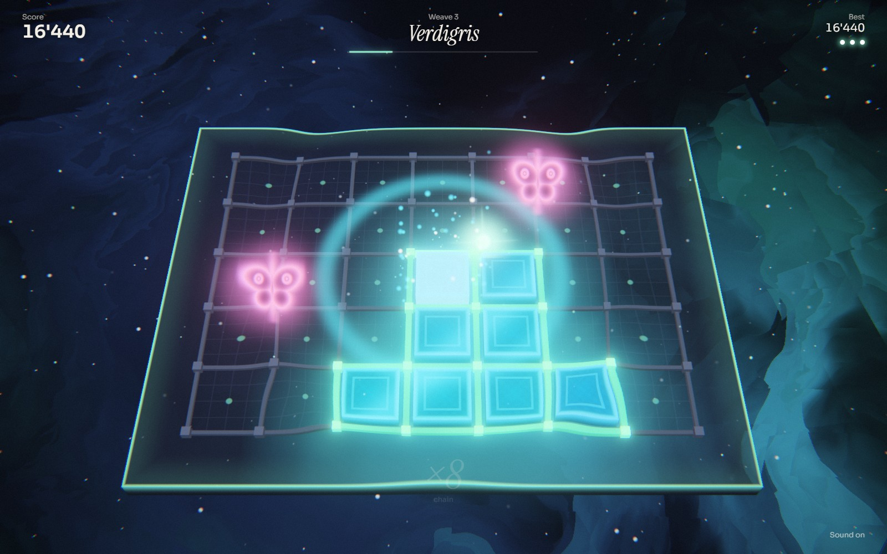

# Gapper

Two browser games inspired by the 1986 DOS arcade game, built to compare what different AI assistants produce from the same brief. In both, you run along the lines of a grid and color each one while a pursuer hunts you.

| Version | Play offline | Source and technical notes |
| --- | --- | --- |
| Claude · Lightloom | [Download the standalone game](https://raw.githubusercontent.com/iago-swi/gapper/main/claude/Lightloom.html) | [claude/](claude/) |
| ChatGPT · Neon Circuit | [Download the standalone game](https://raw.githubusercontent.com/iago-swi/gapper/main/chatgpt/Gapper.html) | [chatgpt/](chatgpt/) |

Save a standalone file with the `.html` extension and open it in a browser. You can also download or clone this repository and open the root `index.html`, a landing page that links to both versions. Each version is self-contained in its own folder, with its own README.

## Claude version



Use the arrow keys or WASD to steer the shuttle. Run the full length of a thread to weave it, and close all four sides of a square to light it. A freshly lit square stuns the moths close by. On a touchscreen, swipe.

## ChatGPT version


Use the arrow keys or WASD to steer. Press **Space** after crossing a rail to break it behind you. On a touchscreen, use the direction pad and **Cut gap**.

## Game history

*Gapper* appeared on DOS in 1986. It belongs to the line-coloring tradition of *Amidar*. Each screen posed a route-planning problem. To finish the grid, the player had to cross every line while a single pursuer, the Seeker, tried to intercept them. Revisiting a junction was often necessary to reach a line left behind. [MobyGames](https://www.mobygames.com/game/32278/gapper/) · [Abandonware DOS](https://www.abandonwaredos.com/abandonware-game.php?abandonware=Gapper&gid=3218)

The move that gave *Gapper* its name let the player temporarily break a line. A well-timed gap forced the Seeker onto a longer route. It also blocked the player’s own return, so the position of the next junction mattered as much as the distance to the enemy. [Squakenet](https://www.squakenet.com/game/gapper/) · [Watch the DOS game](https://www.youtube.com/watch?v=hsFy7OdexQw&t=20s)

*Neon Circuit* brings that chase to the browser. The grid becomes a set of glowing rails above a pixel-art city, while the original decision survives on a single key. A gap buys you a few seconds to reach the next turn.

*Lightloom* keeps the line coloring and the chase and replaces the gap with a different defense. The grid is a loom of light floating in a nebula, and the pursuers are moths. Closing a square stuns the moths near it, so the safest route is often the one that completes a square just as a moth arrives.

## Repository structure

```text
gapper/
├── claude/        Lightloom: game, source, screenshot and technical notes
├── chatgpt/       Neon Circuit: game, editable source, screenshot and technical notes
├── index.html     Landing page that links to both versions
└── README.md
```
