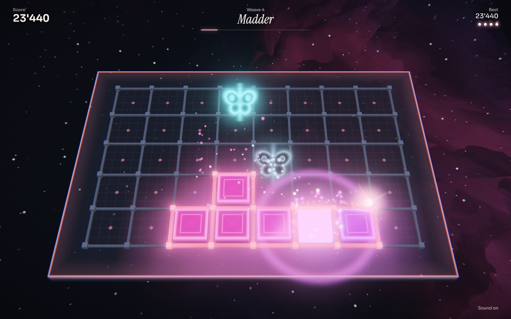
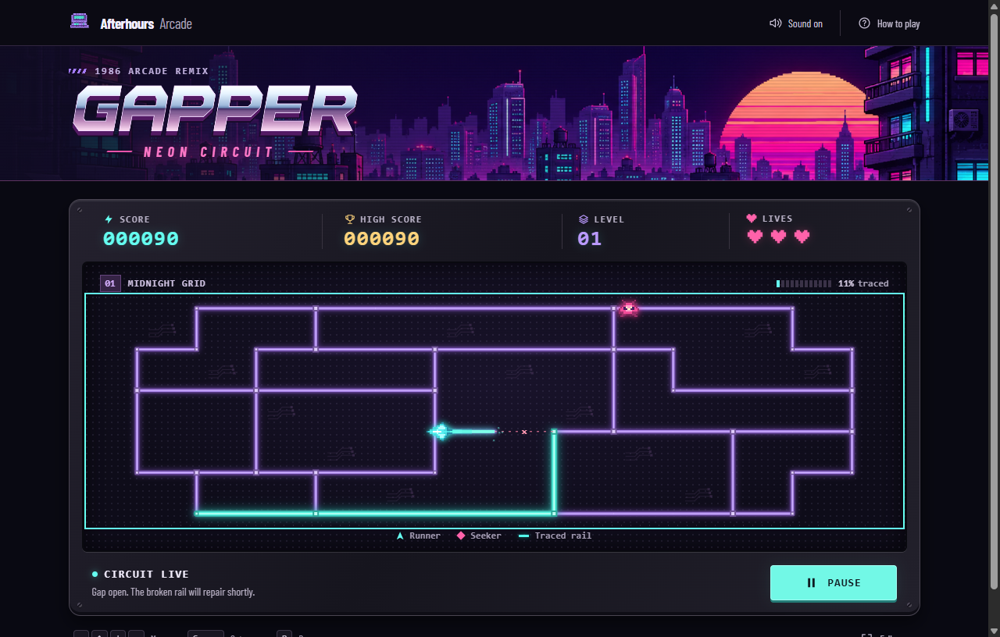

# Gapper

Three browser games inspired by the 1986 DOS arcade game, built to compare what different AI assistants produce from the same brief. In each, you run along the lines of a grid and color them while pursuers hunt you.

**Play it in your browser: <https://iago-swi.github.io/gapper/>**

| Version | Play | Play offline | Source and technical notes |
| --- | --- | --- | --- |
| Claude · Lightloom | [Play](https://iago-swi.github.io/gapper/Claude/) | [Download the standalone game](https://raw.githubusercontent.com/iago-swi/gapper/main/Claude/Lightloom.html) | [Claude/](Claude/) |
| ChatGPT · Neon Circuit | [Play](https://iago-swi.github.io/gapper/ChatGPT/) | [Download the standalone game](https://raw.githubusercontent.com/iago-swi/gapper/main/ChatGPT/Gapper.html) | [ChatGPT/](ChatGPT/) |
| Gemini · Prism | [Play](https://iago-swi.github.io/gapper/Gemini/) | Clone or download and open [Gemini/index.html](Gemini/index.html) | [Gemini/](Gemini/) |

To play offline, save a standalone file with the `.html` extension and open it in a browser, or download/clone this repository and open the root `index.html`, a landing page that links to all three versions. Each version is self-contained in its own folder, with its own README.

## Claude version



Use the arrow keys or WASD to steer the shuttle. Run the full length of a thread to weave it, and close all four sides of a square to light it. A freshly lit square stuns the moths close by. On a touchscreen, swipe. The title screen also offers first-person steering, where the left and right keys turn the shuttle. The ten best scores are kept in the browser, with initials, and a second list is shared between all players. When a game ends you can start again or go back to the title screen, and a paused game can be ended early with its score kept.

## ChatGPT version



Turn every violet rail cyan before the pink seeker catches you. Press **Space** after crossing a rail to break it behind you. On a touchscreen, use the direction pad and **Cut gap**. Choose **Third person** for screen-relative steering and instant reversals, or **First person** to steer left and right from the ship’s point of view. At game over, sign your score with up to three initials and compare your rank on **This device** and **Everyone**, the leaderboard shared by Neon Circuit players. Choose **Play again** for another run or **Quit** to return to the start screen.

## Gemini version


Use the arrow keys or WASD to trace glowing conduits and enclose staggered chambers across 6 handcrafted sectors. Press **Space** (or **Shift** / **E**) to sever the rail behind you with a crackling **Plasma Gap** that stuns or traps Seekers, and seal all 4 diamond-marked corner chambers to ignite **Prism Overdrive**. The title and pause screens also offer first-person steering, where left and right turn the ship relative to its direction of travel while it moves automatically. The ten best scores are stored on the device with initials, alongside a shared leaderboard across all players of Prism. Full architecture, shader, and AI notes are in [Gemini/README.md](Gemini/README.md).

## Game history

*Gapper* appeared on DOS in 1986. It belongs to the line-coloring tradition of *Amidar*. Each screen posed a route-planning problem. To finish the grid, the player had to cross every line while a single pursuer, the Seeker, tried to intercept them. Revisiting a junction was often necessary to reach a line left behind. [MobyGames](https://www.mobygames.com/game/32278/gapper/) · [Abandonware DOS](https://www.abandonwaredos.com/abandonware-game.php?abandonware=Gapper&gid=3218)

The move that gave *Gapper* its name let the player temporarily break a line. A well-timed gap forced the Seeker onto a longer route. It also blocked the player’s own return, so the position of the next junction mattered as much as the distance to the enemy. [Squakenet](https://www.squakenet.com/game/gapper/) · [Watch the DOS game](https://www.youtube.com/watch?v=hsFy7OdexQw&t=20s)

*Neon Circuit* brings that chase to the browser. The grid becomes a set of glowing rails above a pixel-art city, while the original decision survives on a single key. A gap buys you a few seconds to reach the next turn.

*Lightloom* keeps the line coloring and the chase and replaces the gap with a different defense. The grid is a loom of light floating in a nebula, and the pursuers are moths. Closing a square stuns the moths near it, so the safest route is often the one that completes a square just as a moth arrives.

*Prism* pairs the classic Gap severance with staggered Amidar-style chamber enclosures, 3 escalating Seeker archetypes, and a 4-pass WebGL 2 optical bloom and shockwave pipeline over an architectural smoked-obsidian monolith.

## Releases

Each game is numbered separately and has its own release notes. The [Releases page](https://github.com/iago-swi/gapper/releases) lists every numbered release, with the standalone game of that release attached where there is one. The numbering rules are in [VERSIONING.md](VERSIONING.md).

| Game | Release notes |
| --- | --- |
| Lightloom | [Claude/CHANGELOG.md](Claude/CHANGELOG.md) |
| Neon Circuit | [ChatGPT/CHANGELOG.md](ChatGPT/CHANGELOG.md) |
| Prism | [Gemini/CHANGELOG.md](Gemini/CHANGELOG.md) |

## Repository structure

```text
gapper/
├── Claude/        Lightloom: game, source, screenshot and technical notes
├── ChatGPT/       Neon Circuit: game, editable source, screenshot and technical notes
├── Gemini/        Prism: WebGL 2 game, screenshot and technical notes
├── index.html     Landing page that links to all three versions
├── VERSIONING.md  How the games are numbered and released
└── README.md
```
